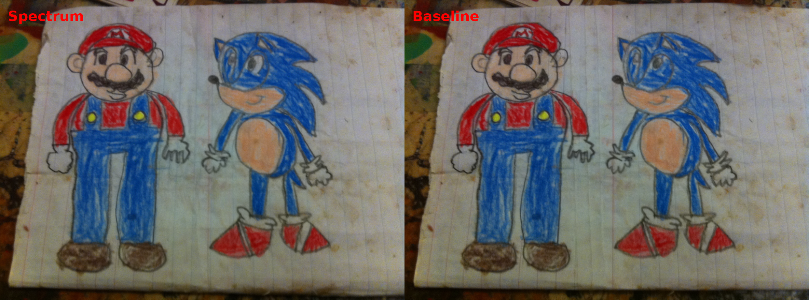
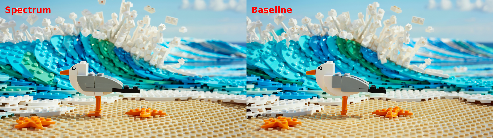
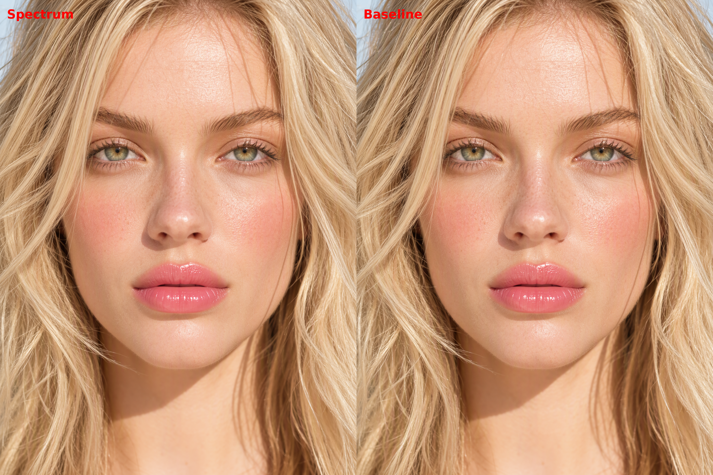

# ComfyUI-Spectrum-MOSS

Spectrum-style hidden-state forecasting ComfyUI node for **MOSS-Image**.
vibe-coded

This build contains two nodes:

- **Spectrum MOSS-Image (Manual)** - Manually choose forecast steps after warmup
- **Spectrum MOSS-Image (Adaptive)** - Experimental node. It will try to adapt the forecast steps with forecast error estimation to maintain quality. Speed can be vary

Default (adaptive) scheduling behavior:

1. First (warmup) steps are actual transformer evaluations.
2. The next few steps (detail_guard) allow at most 1 forecast between actual refreshes.
3. After the guard, the scheduler can expand the forecast horizon up to the configured cap (post_guard_cap).
4. The final (tail) 2 steps are actual evaluations.

## Recommended settings
 I only tested with:
- 50 sampling steps  (If you want to use a different number of total steps, adjust spectrum's steps accordingly) 
- Euler + sgm_uniform
- Other schedulers should run. Other samplers may not run well.

Speed gain is about x2 - x2.5 with the default setup

Default settings are on the safer side. If you want more speed, increase max_consecutive_forecasts, and/or reduce warmup_steps/tail_actual_steps. 

Detail_guard allows at most 1 forecast during this window. A higher error_tolerance value allows more "room for error" after guard steps.  Both values may also affect speed.

## Examples 

  
  
   

## Credits
Spectrum method / paper:

- **Adaptive Spectral Feature Forecasting for Diffusion Sampling Acceleration** — arXiv:2603.01623
- Official implementation: https://github.com/hanjq17/Spectrum

## License

GPL-3.0-only. See `LICENSE`.

SPDX-License-Identifier: GPL-3.0-only
