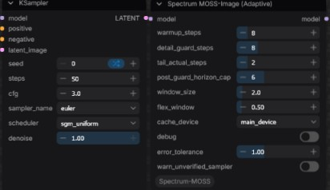
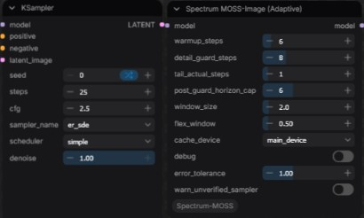
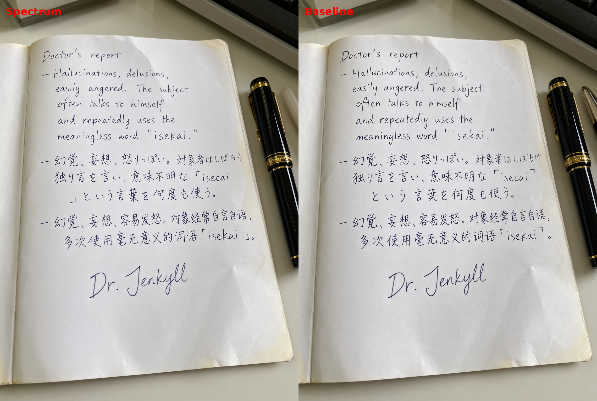

# ComfyUI-Spectrum-MOSS

Spectrum-style hidden-state forecasting ComfyUI node for **MOSS-Image**.  
vibe-coded

This build contains two nodes:

- **Spectrum MOSS-Image (Manual)** - Manually choose forecast steps after warmup
- **Spectrum MOSS-Image (Adaptive)** - Experimental node. It will try to adapt the forecast steps with forecast error estimation to maintain quality. Speed may vary.

Default (adaptive) scheduling behavior:

1. First (warmup) steps are actual transformer evaluations.
2. The next few steps (detail_guard) allow at most 1 forecast between actual refreshes.
3. After the guard, the scheduler can expand the forecast horizon up to the configured cap (post_guard_cap).
4. The final (tail) steps are actual evaluations.

## Recommended settings

OpenMOSS official suggestion: 50 steps / Euler + sgm_uniform

Comfy-Org template: 25 steps / er_sde + simple

- er_sde is supported through a solver bridge. Max_consecutive_forecasts = 1 is the recommended setting for this sampler. Adaptive node will force post_guard_horizon_forecast =< 2 when er_sde is detected.
- If you use SkipLayerGuidance, set start & end to 0.000-1.000. Partial ranges like 0.000-0.500 will make Spectrum relearn at the transition, so there may be fewer forecast steps.
- Other schedulers should run. Other samplers may not run well.

Speed gain is about 2x - 2.5x with the default setup.

Default settings are on the safer side. If you want more speed, increase max_consecutive_forecasts and/or reduce warmup_steps/tail_actual_steps.

Detail_guard allows at most 1 forecast during this window. Higher error_tolerance allows more room for error after guard steps. Both values may affect speed.

## Examples

  
  
  
  

## Credits

Spectrum method / paper:

- **Adaptive Spectral Feature Forecasting for Diffusion Sampling Acceleration** — arXiv:2603.01623
- Official implementation: https://github.com/hanjq17/Spectrum
- https://github.com/xmarre/ComfyUI-Spectrum-MiniMax-H3 (solver-space ER-SDE bridge approach)

## License

GPL-3.0-only. See `LICENSE`.

SPDX-License-Identifier: GPL-3.0-only
